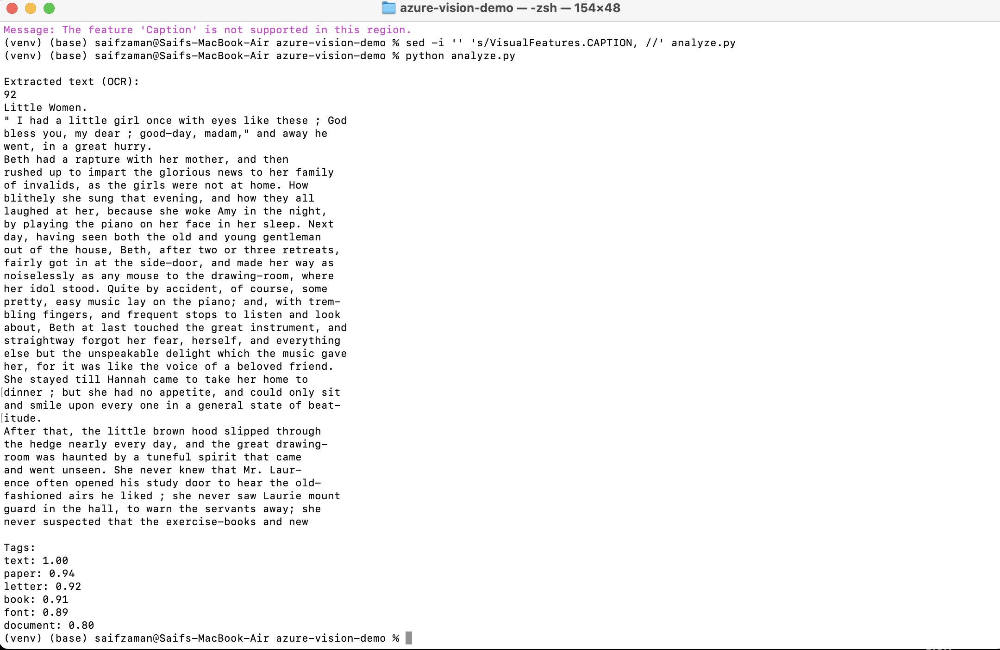

# Azure AI Vision OCR Demo

## Overview
This project is a small Python script that uses Azure AI Vision (Image Analysis 4.0) to read text from an image and describe what the image contains. It sends an image to Azure, gets back the text line by line (OCR) and a list of tags with confidence scores, and prints the results in the terminal.

I built it to get hands on experience with Azure AI services and the Azure Python SDK.

## Problem Statement
A lot of useful information is stuck inside images, such as scanned book pages, receipts and printed documents. Typing that text out by hand is slow and easy to get wrong. This project tests how a cloud AI service can turn an image of printed text into machine readable text that can then be searched, stored or analyzed.

## Architecture
```
Local image (page.jpeg)
        |
        v
Python script (analyze.py)
  - reads endpoint and key from environment variables
  - sends image bytes using the Azure SDK
        |
        v
Azure AI Vision (Image Analysis 4.0)
  - READ feature: extracts text (OCR)
  - TAGS feature: identifies image content
        |
        v
JSON response -> printed in the terminal
  - extracted text, line by line
  - tags with confidence scores
```

## Tech Stack
- Python 3.13
- Azure AI Vision (Image Analysis 4.0), Free F0 tier
- azure-ai-vision-imageanalysis (Azure Python SDK)
- azure-core (key based authentication)
- macOS Terminal and a Python virtual environment

## User Stories & Acceptance Criteria

**User story 1:** As a user, I want to extract the text from an image of a printed page, so that I don't have to type it out by hand.
- The script prints every line of text found in the image, in reading order.
- Line breaks and punctuation match the original page closely.

**User story 2:** As a user, I want to know what kind of image I uploaded, so that I can sort or label images automatically.
- The script returns a list of tags for the image.
- Each tag shows a confidence score between 0 and 1.

**User story 3:** As a developer, I want my Azure credentials kept out of the code, so that they are never exposed on GitHub.
- The endpoint and key are read from environment variables.
- No secrets appear in any file in the repository.

## How to Run
```bash
python3 -m venv venv
source venv/bin/activate
pip install -r requirements.txt
export VISION_ENDPOINT="your-endpoint"
export VISION_KEY="your-key"
python analyze.py
```

## Evaluation & Testing
The script was tested on a scanned page from *Little Women* (a public domain book). I compared the OCR output with the original page by reading them side by side.

Results:
- Every line on the page was extracted, including the page number and the running header.
- Words split across lines with hyphens (for example "trem-" and "bling") were kept exactly as printed.
- Punctuation such as quotation marks, commas and semicolons was preserved.
- The top tags were text (1.00), paper (0.94), letter (0.92) and book (0.91), which correctly describe the image.

Testing was done manually on one image, so these results show that the pipeline works, not how accurate it is across many documents.

## Sample Output


## Limitations
- It processes one image at a time.
- It was tested only on clean printed text, not handwriting, low quality photos or other languages.
- The Caption feature is not available in every Azure region, so it is turned off in this version.
- The free tier has call limits, so it is not suited for large batches.
- Results are printed to the terminal and are not saved to a file.
- There is no automated accuracy measurement yet.

## Future Work
- Process a whole folder of images and save the results to a CSV file.
- Measure OCR accuracy automatically using character error rate against known text.
- Test on handwriting, receipts and lower quality photos.
- Enable captions by using a resource in a supported region.
- Add error handling and retries for failed requests.
- Build a simple web interface where users can upload an image and see the text.
